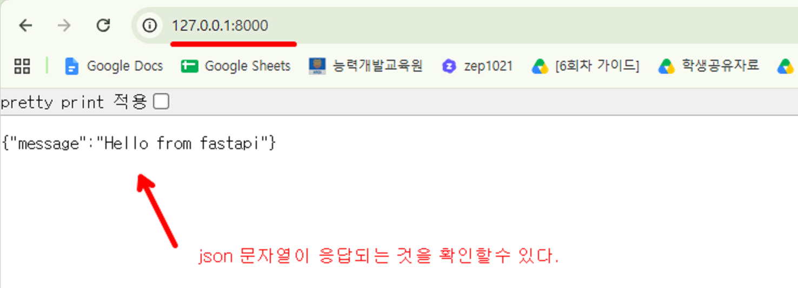
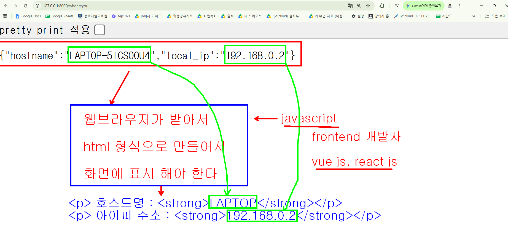
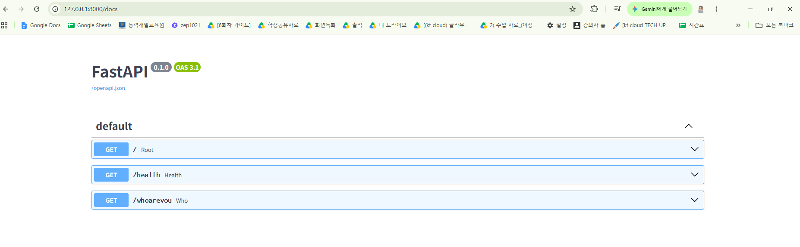

# fastapi 를 사용해 보자 

## 환경구성

```bash
# python 가상환경 만들기
python -m venv venv

# 가상 환경 활성화
.\venv\Scripts\activate

# 필요한 페키지 설치
pip install fastapi uvicorn

# app 시작하기 (main.py 파일안에 있는 app 객체를 참조)
uvicorn main:app --reload
```



## 응답된 json 문서를 활용하는 구조


## api 문서 확인

<a href="http://127.0.0.1:8000/docs">http://127.0.0.1:8000/docs</a>



## 가상환경으로 구성된 현재 환경을 다른 서버에서 재현하려면 ?

```bash
# 현재 환경을 requirements.txt 파일에 기록하기 (의존성 기록하기)
pip freeze > requirements.txt

# requirements.txt 파일을 이용해서 의존성을 다른 곳에서 설치하는 방법
pip install -r requirements.txt

```